<div align="center">
  

# Arrakis Control Dashboard

**A modern command center for Dune: Awakening server administration, guild operations, and community management.**

[Overview](#overview) · [Features](#features) · [Screenshots](#screenshots) · [Quick start](#quick-start) · [Deployment](#production-deployment) · [Development](#development) · [Contributing](#contributing)

[](https://github.com/RealXKenny/Arrakis-Control-Dashboard/actions/workflows/ci.yml)
[](https://github.com/RealXKenny/Arrakis-Control-Dashboard/releases/latest)
[](LICENSE)
[](https://nodejs.org/)
[](https://www.typescriptlang.org/)
[](CONTRIBUTING.md)
</div>

## Overview

Arrakis Control is a self-hosted Next.js dashboard for authorized Dune: Awakening communities. It brings player telemetry, live maps, guild recruitment, base sharing, market data, and scoped server administration into one Dune-inspired workspace.

The application uses Discord OAuth and linked email/password sign-in, server-verified guild roles, Redis-backed sessions, and explicit administrator authorization. Credentials and provider responses stay on the server.

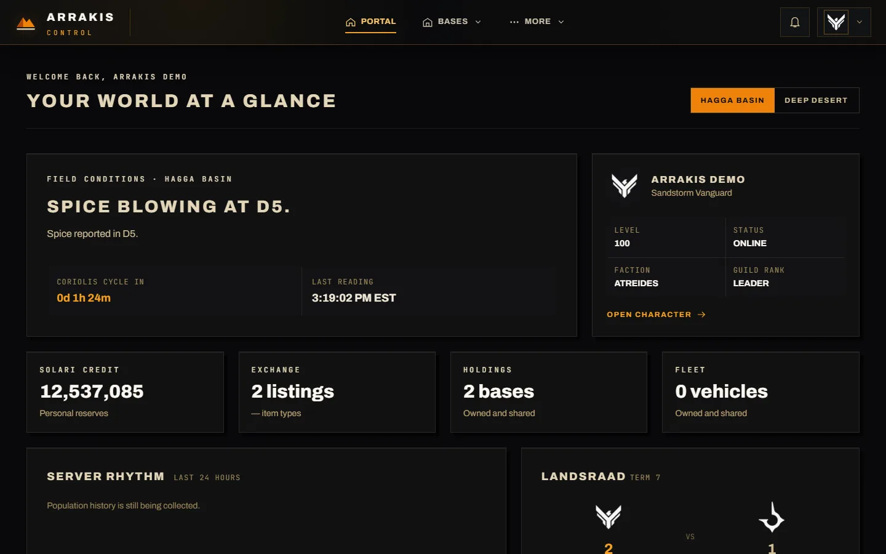

_The dashboard overview in an isolated demonstration environment. All people, guilds, servers, and measurements shown are fictional fixtures, not production data._

## Features

### Command center

- **Server overview:** health, CPU, memory, population, services, and read-source status where the Console reports them.
- **Scoped administration:** dedicated screens for players, guilds, bases, vehicles, maps, market, backups, logs, updates, addons, and server controls.
- **Operational safeguards:** scoped credentials, same-origin mutations, confirmation dialogs, bounded transfers, and redacted audit events.
- **Maps and telemetry:** interactive Hagga Basin and Deep Desert maps, optional realtime layers, population history, and world briefings.

### Players and community

- **Player profiles:** character status, progression, factions, inventory, vehicles, bases, and journey information.
- **Guild management:** roster ranks, member addition/removal, leadership controls, settings, and leader support conversations.
- **Recruitment and applications:** customizable application questions, applicant status, leader review, private chat, and unread receipts.
- **Base marketplace:** owner-verified blueprint sharing, captured front pictures, interactive previews, and checked imports.

### Integration and access

- Discord OAuth with guild-membership and role re-verification.
- Email/password login linked to a Discord-verified email address.
- Redis standalone or Cluster support for sessions, rate limits, and feature records.
- A versioned, token-authorized, read-only bot API for sanitized world summaries.
- Release announcements through an optional Discord webhook.

The administration catalog distinguishes available operations, restricted Console-only operations, and planned or unsupported entries. Experimental adapter tools depend on the installed provider and configured scopes; the README does not claim that every catalog operation is supported by every Console installation.

## Screenshots

### Command center

| Dashboard overview                                                                                                              | Server monitoring                                                                                                                                |
| ------------------------------------------------------------------------------------------------------------------------------- | ------------------------------------------------------------------------------------------------------------------------------------------------ |
|  | 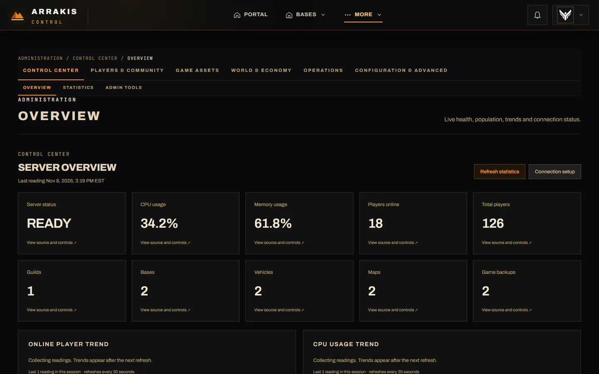 |
| World conditions, character status, and current holdings.                                                                       | Health, resource usage, services, and connection checks.                                                                                         |

| Server management                                                                                                                              | Administration workspace                                                                                                       |
| ---------------------------------------------------------------------------------------------------------------------------------------------- | ------------------------------------------------------------------------------------------------------------------------------ |
| 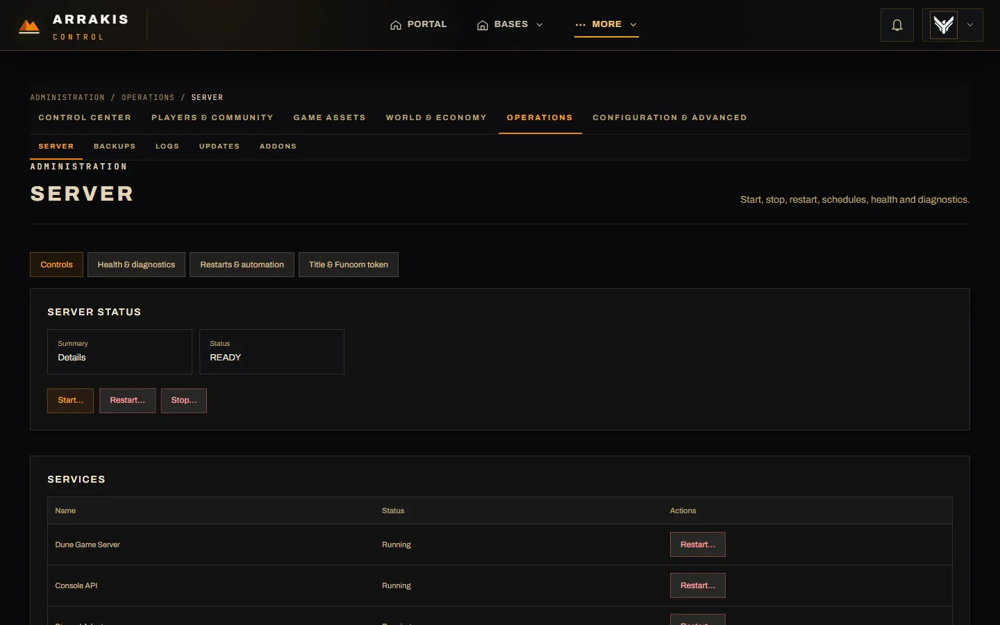 | 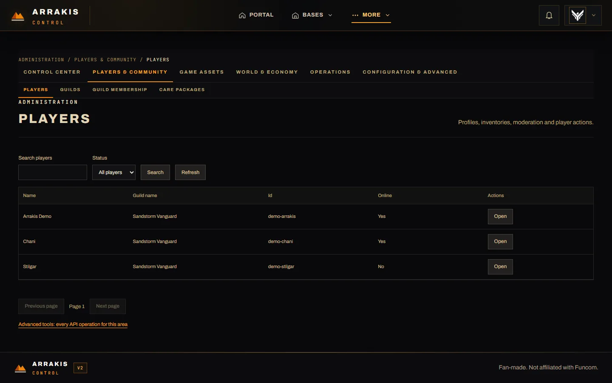 |
| Service diagnostics and confirmation-protected server controls.                                                                                | Grouped administrative tools with scoped provider access.                                                                      |

### Guild operations

| Guild management                                                                                                                 | Guild recruitment                                                                                                                                                |
| -------------------------------------------------------------------------------------------------------------------------------- | ---------------------------------------------------------------------------------------------------------------------------------------------------------------- |
| 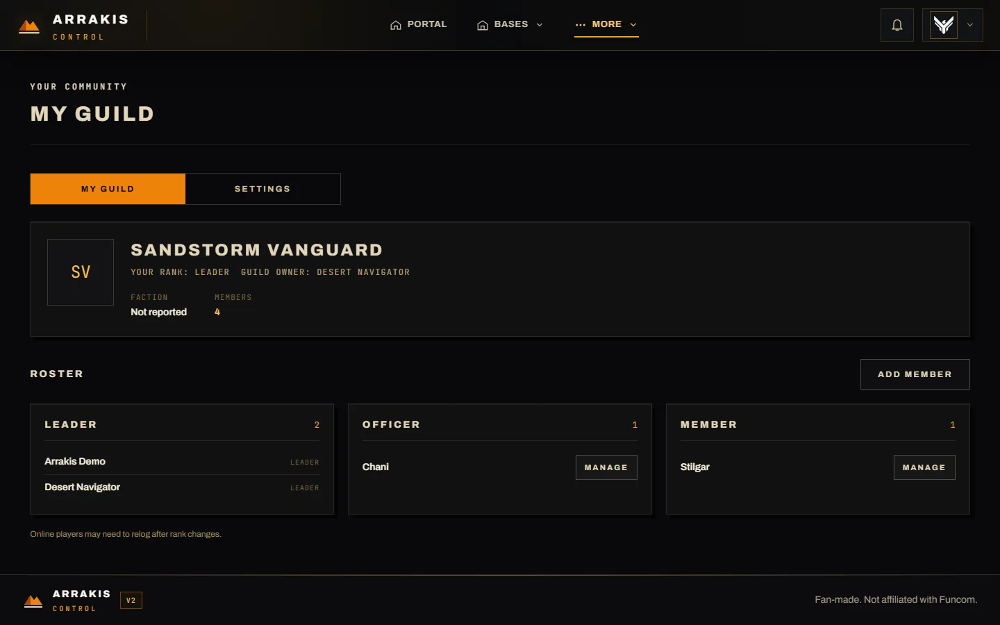 | 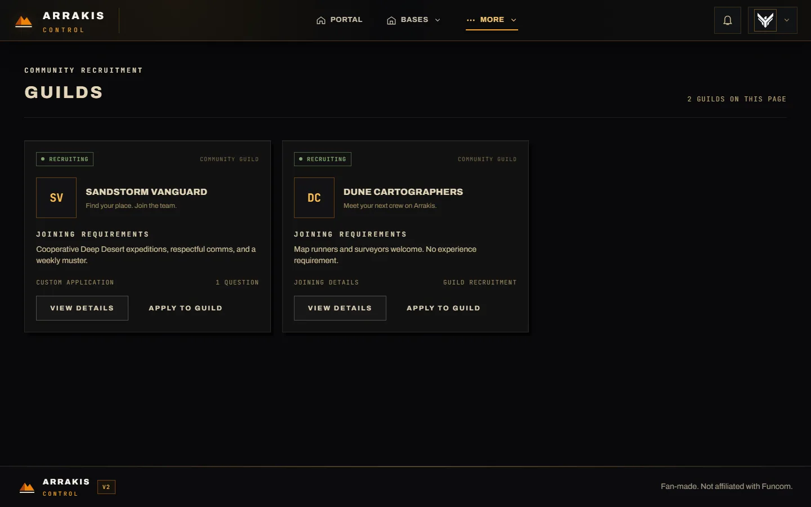 |
| Roster, rank, emblem, and leader-only controls.                                                                                  | Published requirements and application entry points.                                                                                                             |

| Guild applications                                                                                                                                    | Guild settings                                                                                                                     |
| ----------------------------------------------------------------------------------------------------------------------------------------------------- | ---------------------------------------------------------------------------------------------------------------------------------- |
| 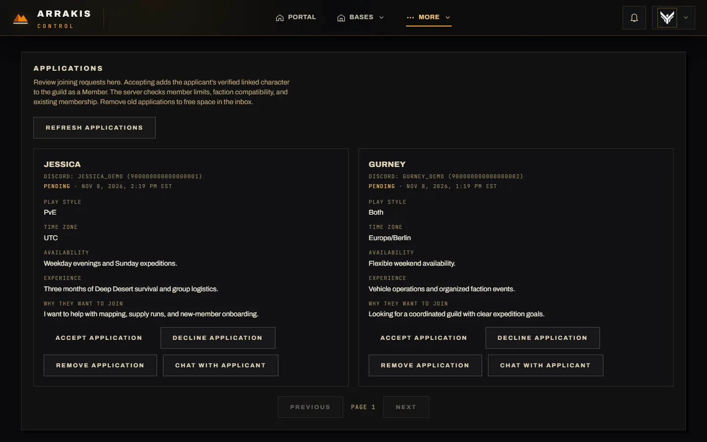 | 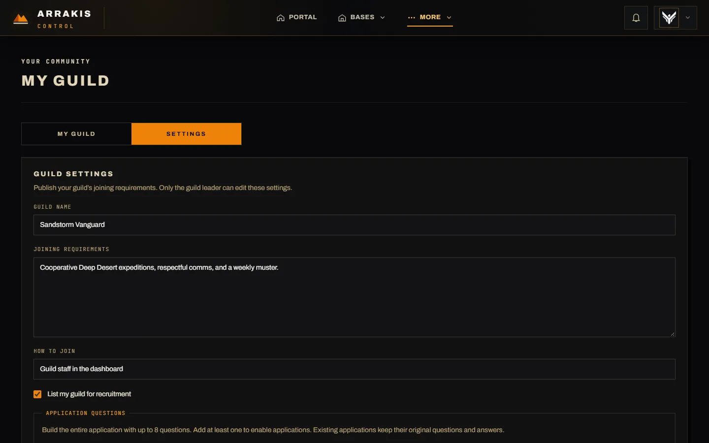 |
| Application answers, review actions, and applicant conversations.                                                                                     | Recruitment settings, applications, support, and guild administration.                                                             |

### Player profile and mobile workspace

| Character profile                                                                                                                                    | Mobile dashboard                                                                                                        |
| ---------------------------------------------------------------------------------------------------------------------------------------------------- | ----------------------------------------------------------------------------------------------------------------------- |
| 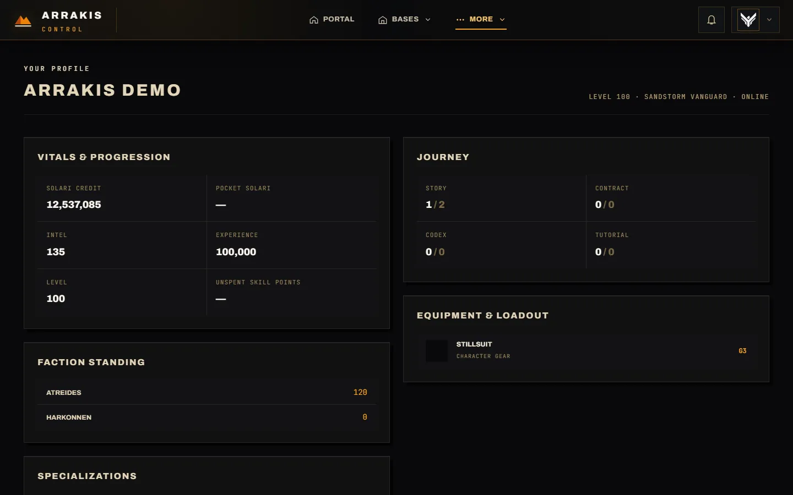 | 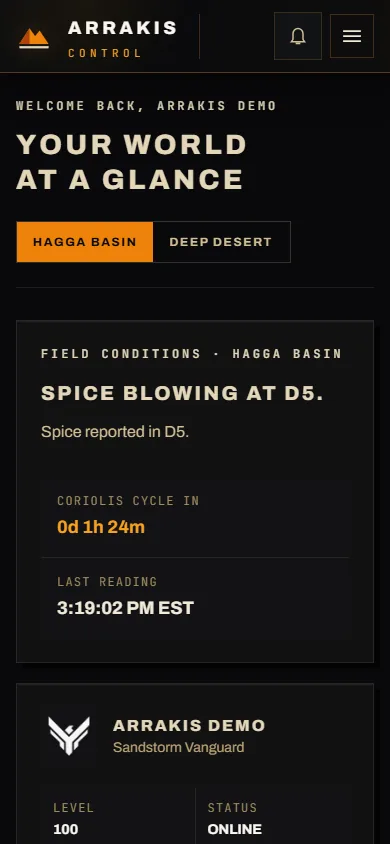 |
| Character progression, journey, equipment, and faction data.                                                                                         | The real responsive workspace at a 390 × 844 viewport.                                                                  |

## Technology stack

| Technology              | Role                                                                      |
| ----------------------- | ------------------------------------------------------------------------- |
| Next.js 16 and React 19 | App Router application, server rendering, and route handlers              |
| TypeScript              | Application, validation, and test code                                    |
| Node.js 22+             | Runtime and maintenance/deployment tooling                                |
| Auth.js                 | Discord OAuth and credentials authentication                              |
| Redis with ioredis      | Sessions, rate limits, caches, and feature records; standalone or Cluster |
| Tailwind CSS 4          | Obsidian/Sand/Spice design system and responsive UI                       |
| Three.js                | Interactive 3D maps and base previews                                     |
| Vitest and Playwright   | Unit, API, architecture, integration, runtime, and browser verification   |

There is no PostgreSQL database in this project. Redis is the only persistent application store.

## Architecture

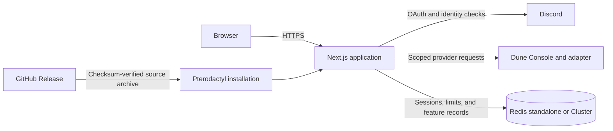

Feature code lives in `src/features/`, route entry points in `src/app/`, shared UI in `src/components/`, and request/provider infrastructure in `src/server/`. See [file organization](docs/architecture/file-organization.md) for placement rules and the [repository inventory](docs/architecture/repository-inventory.md) for the complete map.

## Quick start

### Requirements

- Node.js 22 or newer and npm.
- A reachable Dune Console instance and adapter configuration.
- A Discord application configured for OAuth.
- Redis for persistent production sessions and shared limits.

### Install and run

```powershell
npm ci
Copy-Item .env.example .env
npm run dev
```

Fill `.env` using real local or deployment values, then open **http://127.0.0.1:2008**. The launcher prints `Arrakis Control Dashboard is listening` after its HTTP readiness check succeeds.

Never commit `.env` or place secrets in `NEXT_PUBLIC_` variables.

## Environment configuration

Use [`.env.example`](.env.example) as the complete template. The main settings are:

| Setting                                                          | Purpose                                                                                        |
| ---------------------------------------------------------------- | ---------------------------------------------------------------------------------------------- |
| `CONSOLE_URL`, `CONSOLE_API_KEY`, `ADAPTER_TOKEN`                | Dune Console and adapter access                                                                |
| `DISCORD_CLIENT_ID`, `DISCORD_CLIENT_SECRET`, `DISCORD_GUILD_ID` | Discord OAuth and guild authorization                                                          |
| `VERIFIED_MEMBER_ROLE_ID`                                        | Required member role                                                                           |
| `APP_URL`                                                        | Canonical public origin; the callback is `<APP_URL>/api/auth/callback/discord`                 |
| `AUTH_SECRET`                                                    | Signs Auth.js state and seals stored Discord refresh tokens; use at least 32 random characters |
| `ADMIN_DISCORD_IDS`                                              | Comma-separated administrator Discord IDs; required in production                              |
| `REDIS_URL`                                                      | Redis connection, credentials, database, and optional TLS                                      |
| `REDIS_CLUSTER_NODES`                                            | Optional Cluster bootstrap nodes; `REDIS_URL` still supplies credentials and TLS               |
| `ADMIN_CONSOLE_API_KEY`                                          | Optional separate credential for scoped administrator operations                               |
| `TRUSTED_PROXY_COUNT`                                            | Exact reverse-proxy count used to select the trusted forwarded address                         |
| `OWNER_KEY_SECRET`                                               | Optional dedicated secret for marketplace ownership keys                                       |
| `BOT_API_TOKEN`                                                  | Optional independent credential for the read-only bot API                                      |
| `CHANGELOG_WEBHOOK_URL`, `CHANGELOG_AUTO_ANNOUNCE`               | Optional Discord release announcements                                                         |

Redis TLS and public-network settings are validated by the current environment schema. Review `REDIS_REQUIRE_TLS` and `REDIS_ALLOW_INSECURE` before deploying outside a trusted network.

## Production deployment

### Pterodactyl

1. Download `egg-arrakis-control-dashboard.json` from the [latest GitHub Release](https://github.com/RealXKenny/Arrakis-Control-Dashboard/releases/latest).
2. Import the egg into a Pterodactyl nest and create a server with the standard Node.js 22 runtime.
3. Assign the application port and complete the required Startup settings.
4. Keep the server volume writable and make Console, Discord, GitHub, and Redis reachable from the container.

The installer selects the newest release or the exact `RELEASE_TAG`, verifies the release archive against its published SHA-256 checksum, checks archive safety, builds the application, and prunes development dependencies. Reinstall to update. There is no custom application image or GHCR package to pull.

### Direct Node.js deployment

```powershell
npm ci
npm run build
npm start
```

Provide the production environment, use HTTPS at the reverse proxy, and configure `TRUSTED_PROXY_COUNT` accurately. Redis is required in production so sessions and rate limits survive restarts and work across instances. Existing deployments adopting hash-tagged keys or Cluster should follow the checked migration commands rather than renaming keys manually.

## Authentication and security

- Redis sessions use opaque cookies and a 30-day lifetime, with explicit sign-out and revocation.
- Discord membership and the required role are re-confirmed after 30 minutes; definitive refusal ends the session. Provider outages allow at most six hours of grace after the last successful confirmation.
- Password login is throttled by address and email. Forwarded addresses are selected using the configured trusted-proxy count.
- `/admin` requires a configured administrator ID, guild membership, role, and valid session. Privileged changes also enforce the configured recent-sign-in windows.
- Scoped provider credentials, same-origin mutation checks, bounded transfers, and recursive secret redaction protect the API boundary.
- Redacted audit events cover administrative and security-sensitive operations. MFA is not currently implemented.

See [SECURITY.md](SECURITY.md) for reporting and operational guidance. The step-by-step release procedure is [PRODUCTION_DEPLOYMENT_CHECKLIST.md](PRODUCTION_DEPLOYMENT_CHECKLIST.md).

## Project structure

```text
src/
├── app/           # Next.js routes, layouts, and framework entry points
├── components/    # Shared navigation, brand, feedback, and UI components
├── features/      # Business domains and their implementations
├── server/        # Shared request infrastructure and provider integrations
├── lib/           # Redis, security, cache, HTTP, formatting, and utilities
├── config/        # Canonical environment and application configuration
├── styles/        # Global styles and design tokens
├── types/         # Shared TypeScript contracts
└── assets/        # Bundled images, terrain, and model resources

scripts/           # Runtime, maintenance, and deployment commands
tests/             # Unit, API, architecture, browser, integration, and load tests
docs/              # Architecture, legal, and documentation assets
```

## Development

| Command                    | Purpose                                                                        |
| -------------------------- | ------------------------------------------------------------------------------ |
| `npm run dev`              | Start the development server                                                   |
| `npm run format:check`     | Check source, test, and script formatting                                      |
| `npm run typecheck`        | Run TypeScript validation                                                      |
| `npm run lint`             | Run ESLint with zero warnings allowed                                          |
| `npm test`                 | Run Vitest unit, API, and architecture tests                                   |
| `npm run test:browser`     | Run Playwright browser tests                                                   |
| `npm run test:production`  | Run the production runtime smoke suite                                         |
| `npm run test:integration` | Run opt-in integration tests against explicitly configured test infrastructure |
| `npm run build`            | Create the production build                                                    |
| `npm start`                | Start the built application                                                    |

For `test:integration`, set only disposable loopback Redis through `TEST_REDIS_URL` or `TEST_REDIS_CLUSTER_NODES`. Those tests flush the selected test database; never point them at a production instance.

## Troubleshooting

- **Startup reports missing settings:** compare the environment with `.env.example`; production requires the Console, Discord, Redis, canonical URL, and administrator settings.
- **Discord cannot complete sign-in:** use `<APP_URL>/api/auth/callback/discord` exactly and verify the guild/role configuration.
- **Console requests fail:** check provider reachability, key scopes, and adapter configuration. Remote administration requires HTTPS; loopback HTTP is supported for local deployments.
- **Redis fails in production:** verify credentials, TLS, network reachability, and Cluster settings. Production does not use the development in-memory fallback.
- **A provider feature is unavailable:** installed Console capabilities and key scopes can differ; unknown measurements remain unknown rather than becoming fabricated zeros.

## Contributing

Contributions of code, tests, documentation, accessibility improvements, and bug reports are welcome. Read [CONTRIBUTING.md](CONTRIBUTING.md), follow the [Code of Conduct](CODE_OF_CONDUCT.md), and open a focused pull request with the problem, solution, and verification performed.

Discuss major features or architectural changes before substantial work. Never include credentials, production data, private messages, or real environment files in an issue or pull request.

## License and attribution

Arrakis Control Dashboard is available under the [MIT License](LICENSE). Copyright notices for Arrakis Control Dashboard contributors and RedBlink are preserved there.

The project incorporates or adapts software from RedBlink's [dune-awakening-selfhost-docker](https://github.com/Red-Blink/dune-awakening-selfhost-docker), also under MIT. See [NOTICE.md](NOTICE.md) for attribution and component terms.

This is an independent community project, not affiliated with or endorsed by Funcom or the owners of Dune: Awakening. Third-party names, trademarks, logos, and artwork belong to their respective owners.
