<div align="center">
  

# Arrakis Control Dashboard

[Overview](#overview) · [**Documentation**](docs/README.md) · [Features](#features) · [Screenshots](#screenshots) · [Quick start](#quick-start) · [Deployment](#production-deployment) · [Development](#development) · [Contributing](#contributing)

[](https://github.com/RealXKenny/Arrakis-Control-Dashboard/actions/workflows/ci.yml)
[](https://github.com/RealXKenny/Arrakis-Control-Dashboard/releases/latest)
[](LICENSE)
[](https://nodejs.org/)
[](https://www.typescriptlang.org/)
[](CONTRIBUTING.md)
</div>

## Overview

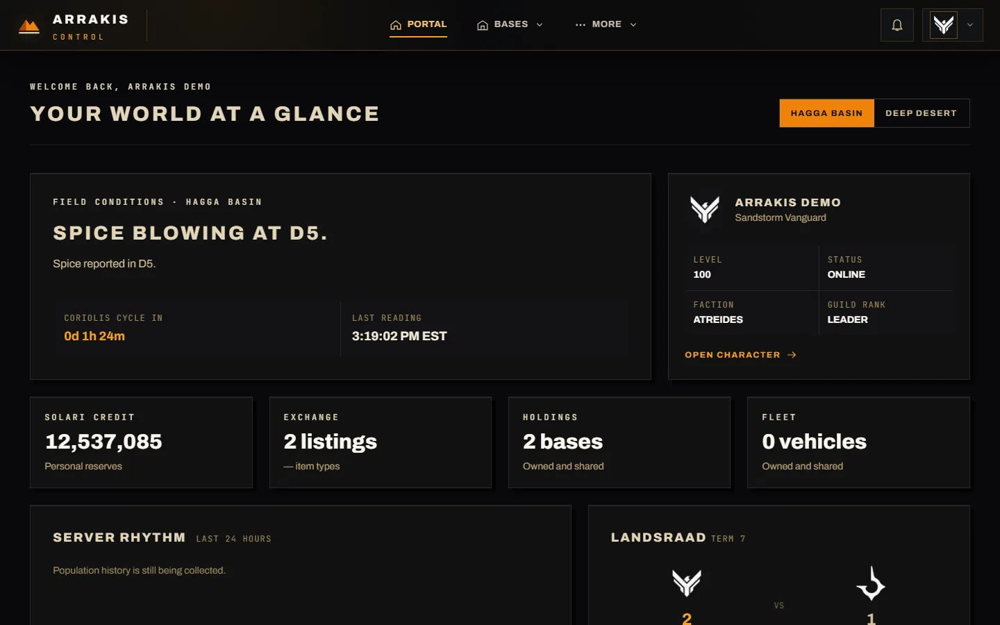

_The dashboard overview in an isolated demonstration environment. All people, guilds, servers, and measurements shown are fictional fixtures, not production data._

## Documentation

**The full documentation center is in [docs/](docs/README.md).** Start with the guide that matches what you are doing:

| I want to…                                    | Go to                                                                                       |
| --------------------------------------------- | ------------------------------------------------------------------------------------------- |
| Set up everything from an empty Linux host    | [End-to-end RedBlink + dashboard setup](docs/getting-started/end-to-end-redblink-setup.md)  |
| Install the dashboard                         | [Installation](docs/installation/README.md) (local, production, Pterodactyl, reverse proxy) |
| Configure Discord, Redis, the Console, admins | [Configuration](docs/configuration/README.md)                                               |
| Connect the RedBlink Dune Docker Console      | [RedBlink integration](docs/integrations/redblink-dune-docker.md)                           |
| Harden and release a production deployment    | [Security](docs/security/README.md) · [Deployment](docs/deployment/README.md)               |
| Look up an endpoint, command or setting       | [API](docs/api/README.md) · [Reference](docs/reference/README.md)                           |
| Fix a problem                                 | [Troubleshooting](docs/troubleshooting/README.md)                                           |
| Contribute code                               | [Development](docs/development/README.md) · [CONTRIBUTING.md](CONTRIBUTING.md)              |

## Features

### Command center

- **Automatic seasons:** a free 100-level engine can generate, publish and archive numbered three-month seasons, verify supported game objectives and claim unlocked profile cosmetics automatically. [Setup and API limits](docs/features/automatic-seasons.md).

- **Server overview:** health, CPU, memory, population, services, and read-source status where the Console reports them.
- **Operational safeguards:** scoped credentials, same-origin mutations, confirmation dialogs, bounded transfers, and redacted audit events.
- **Maps and telemetry:** interactive Hagga Basin and Deep Desert maps, optional realtime layers, population history, and world briefings.
- **Live game chat:** bidirectional Map chat through the existing game RabbitMQ protocol, with a dedicated worker, bounded Redis history, and real-time dashboard updates. See [Live game chat](docs/features/live-chat.md).

### Players and community

- **Appearance studio:** the Console default look, all 66 upstream themes and custom surface/text/accent colors, with shared UI helpers and browser-local persistence. See [Appearance](docs/features/appearance.md).

- **Data freshness:** explicit last-success timestamps, stale/partial/outage indicators and clear-on-failure private readings. See [Data freshness](docs/features/data-freshness.md).
- **Personal data controls:** selectively export notes, plans and retained sharing snapshots, or erase one scope with explicit confirmation and stale-save protection. See [Personal data](docs/features/personal-data.md).
- **Saved activity views:** named widget layouts, inbox/task filters and project/goal context, with capture, duplication and separate data controls. See [Activity views](docs/features/activity-views.md).
- **Command palette:** Ctrl/Command+K for authorized navigation and explicit base/vehicle lookup, plus a mobile-menu entry. See [Command palette](docs/features/command-palette.md).
- **Mobile quick actions:** touch-friendly portal shortcuts for supply searches, owned/shared bases and operation briefings. See [Mobile quick actions](docs/features/mobile-quick-actions.md).
- **Player profiles:** character status, progression, factions, inventory, vehicles, bases, and journey information.
- **Privacy center:** private drafts and reviewed, expiring member-link sharing for profile, location, crafting and supply notes, with per-card unpublishing and revoke-all. See [Privacy center](docs/features/privacy-center.md).
- **Guild management:** roster ranks, member addition/removal, leadership controls, settings, and leader support conversations.
- **Recruitment and applications:** customizable application questions, applicant status, leader review, private chat, and unread receipts.
- **Base marketplace:** owner-verified blueprint sharing, captured front pictures, interactive previews, and checked imports.
- **Dungeon leaderboard:** fastest run per dungeon and difficulty, recent runs with filters and paging, and your own personal bests, read only from the Console's documented dungeon endpoints and shared through the Redis cache. See [Dungeon leaderboard](docs/features/dungeon-leaderboard.md).
- **Public roadmap:** approved, labelled GitHub issues from both Arrakis Control repositories with status, area and confirmed milestone versions only; security and private items are never shown. See [Roadmap](docs/features/roadmap.md).
- **Poker Activity:** optional play-money Texas Hold'em for up to four players, with AI players to fill empty seats, that members open as a Discord Activity launched by the main bot. See [Poker Activity](docs/features/poker-activity.md).

### Integration and access

- Discord OAuth with guild-membership and role re-verification.
- Email/password login linked to a Discord-verified email address.
- Redis standalone or Cluster support for sessions, rate limits, and feature records.
- A versioned, token-authorized, read-only bot API for sanitized world summaries.
- Release, progress, and community event announcements through the main Discord bot using Components V2 containers.
- A shared Redis cache with stale-while-revalidate, last-known-good readings, distributed refresh locks and per-family metrics, so many viewers cost one Console request and an outage shows cached data with a clear stale label. See [Caching](docs/architecture/caching.md).

## Screenshots

### Command center

| Dashboard overview                                        | Server monitoring                                        |
| --------------------------------------------------------- | -------------------------------------------------------- |
| World conditions, character status, and current holdings. | Health, resource usage, services, and connection checks. |

| ---------------------------------------------------------------------------------------------------------------------------------------------- | ------------------------------------------------------------------------------------------------------------------------------ |
| Service diagnostics and confirmation-protected server controls. | Grouped administrative tools with scoped provider access. |

### Guild operations

| Guild management                                                                                                                 | Guild recruitment                                                                                                                                                |
| -------------------------------------------------------------------------------------------------------------------------------- | ---------------------------------------------------------------------------------------------------------------------------------------------------------------- |
| 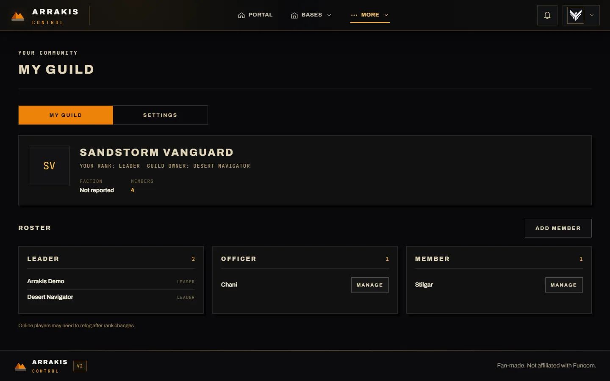 | 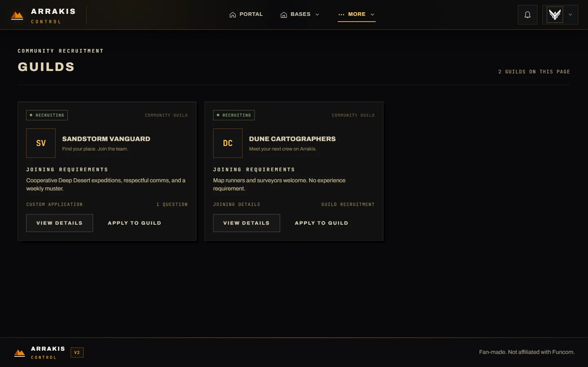 |
| Roster, rank, emblem, and leader-only controls.                                                                                  | Published requirements and application entry points.                                                                                                             |

| Guild applications                                                                                                                                    | Guild settings                                                                                                                     |
| ----------------------------------------------------------------------------------------------------------------------------------------------------- | ---------------------------------------------------------------------------------------------------------------------------------- |
| 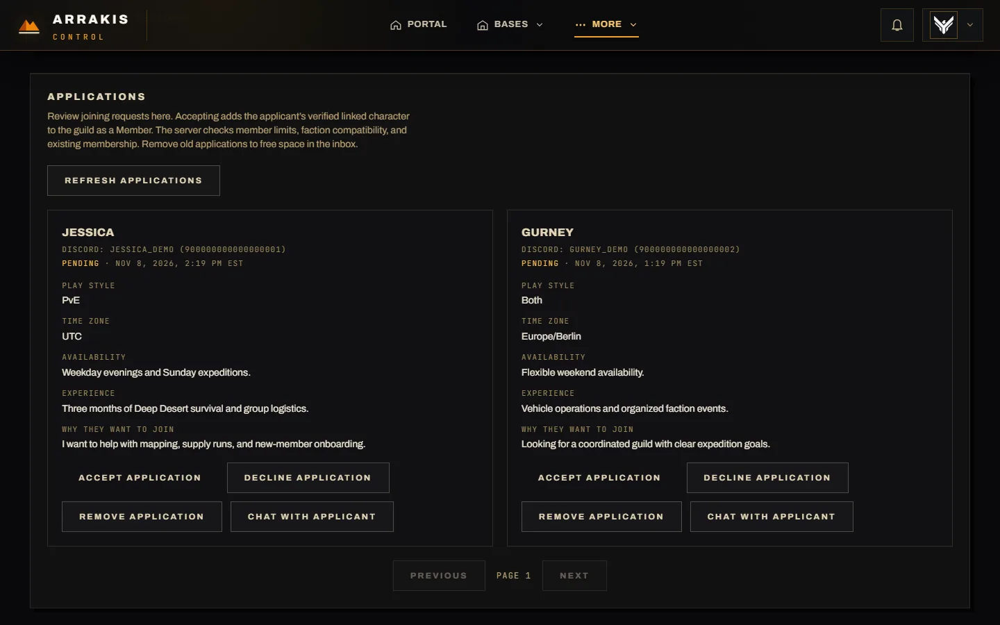 | 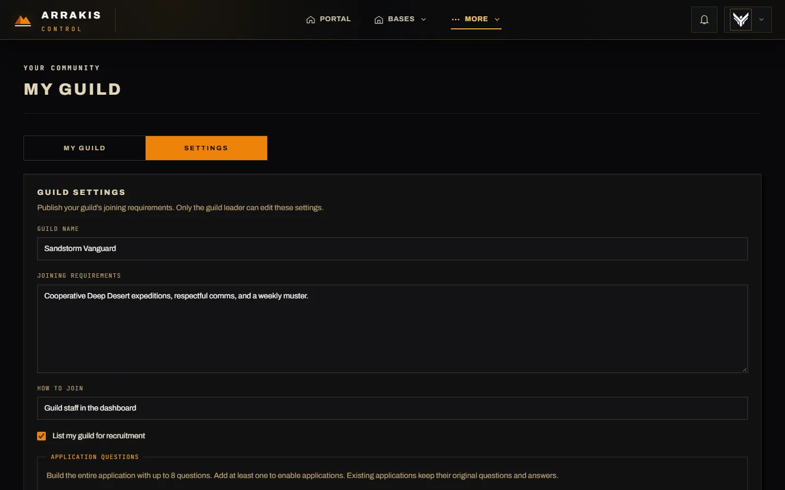 |

### Dungeon leaderboard

| 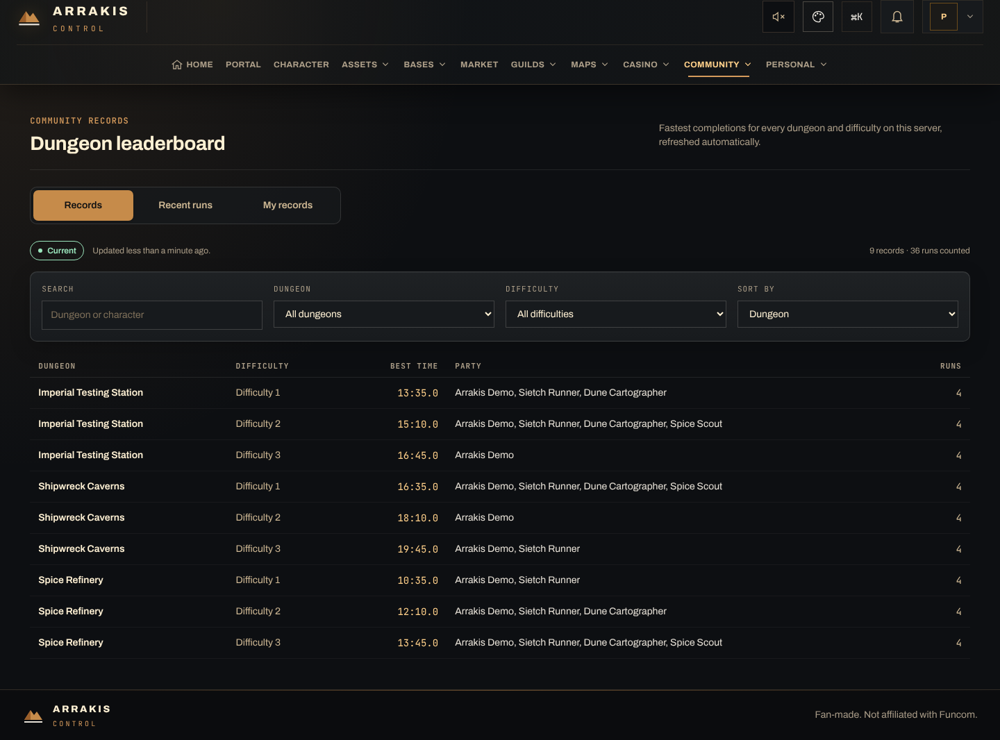 | 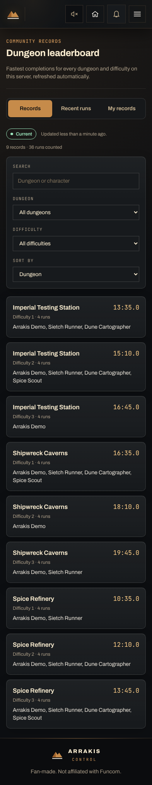 |
| ------------------------------------------------------------------------------------------------------------------------------------------------------------------------------------------- | ------------------------------------------------------------------------------------------------------------------------------------ |
| Records, filters and freshness, captured from the browser test with fictional runs.                                                                                                         | The same view on a phone.                                                                                                            |

### Player profile and mobile workspace

| Character profile                                                                                                                                    | Mobile dashboard                                                                                                        |
| ---------------------------------------------------------------------------------------------------------------------------------------------------- | ----------------------------------------------------------------------------------------------------------------------- |
| 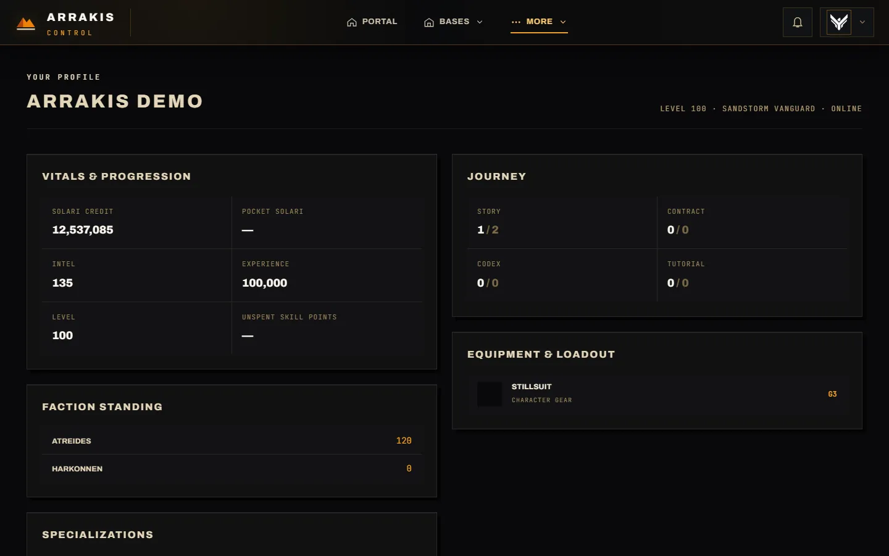 | 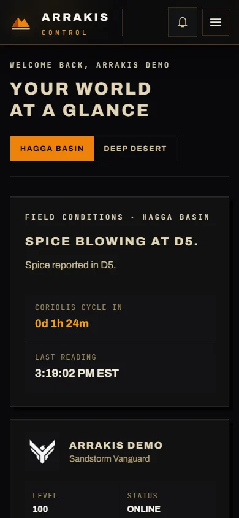 |
| Character progression, journey, equipment, and faction data.                                                                                         | The real responsive workspace at a 390 × 844 viewport.                                                                  |

### V2 release audit

These current captures come from the production build running against sanitized local fixtures. No real account, player, credential or wallet data appears.

| Landing page                                                                                                                          | Casino lobby                                                                                                                                    |
| ------------------------------------------------------------------------------------------------------------------------------------- | ----------------------------------------------------------------------------------------------------------------------------------------------- |
| 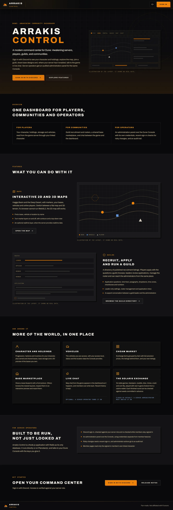 | 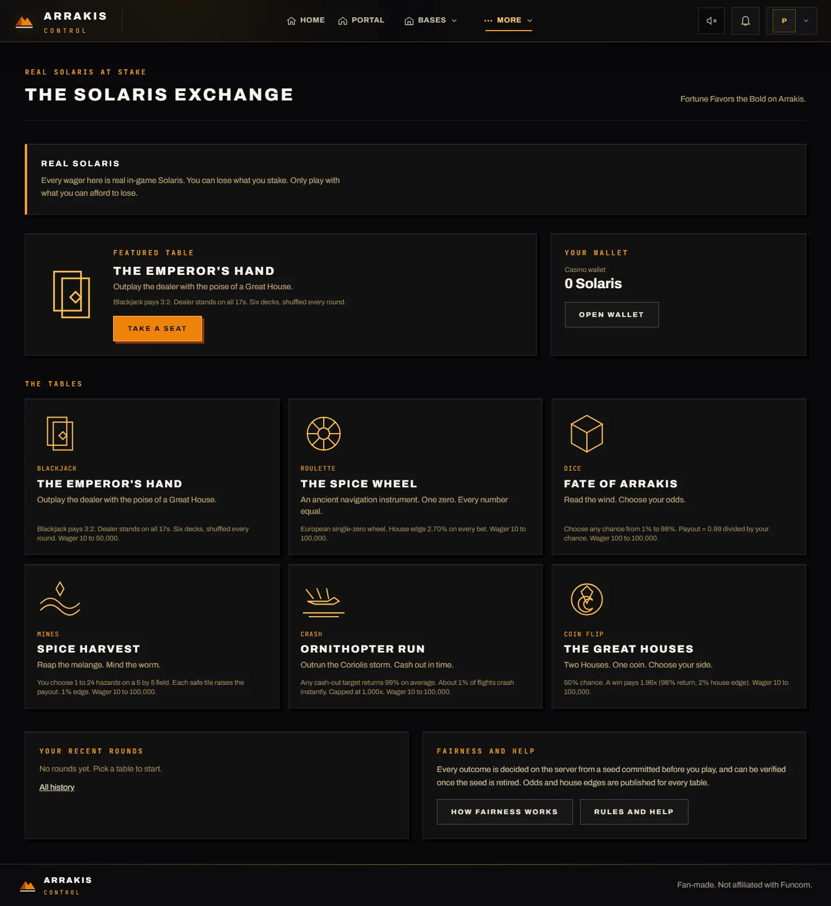 |
| [Mobile landing](docs/assets/screenshots/landing-mobile.webp)                                                                         | [Mobile lobby](docs/assets/screenshots/casino-lobby-mobile.webp)                                                                                |

| Blackjack gameplay                                                                                                                                          | Sound settings and navigation                                                                                                                                     |
| ----------------------------------------------------------------------------------------------------------------------------------------------------------- | ----------------------------------------------------------------------------------------------------------------------------------------------------------------- |
| 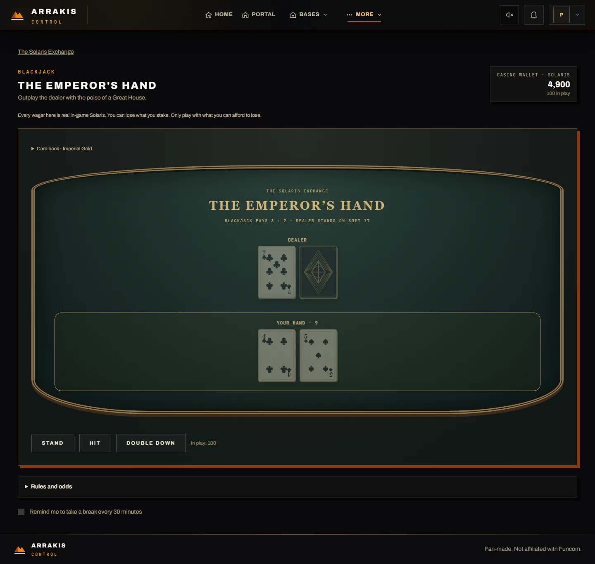 | 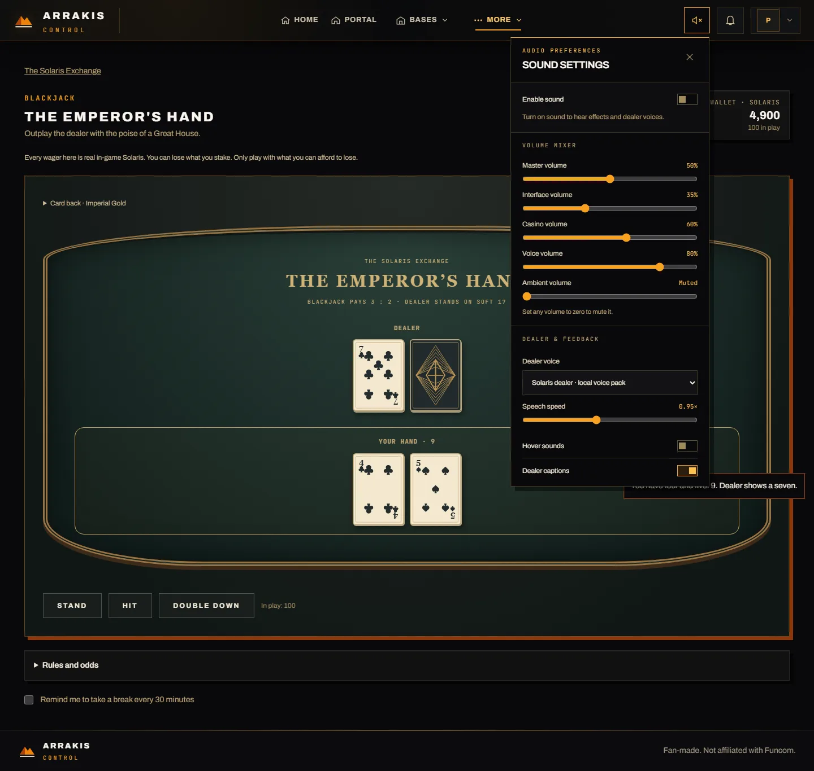                        |
| Original SVG deck and keyboard-accessible actions.                                                                                                          | [Casino navigation menu](docs/assets/screenshots/navigation-casino-menu.webp) · [Mobile navigation drawer](docs/assets/screenshots/navigation-mobile-drawer.webp) |

[Desktop overview](docs/assets/screenshots/dashboard-release-desktop.webp) · [Mobile overview](docs/assets/screenshots/dashboard-release-mobile.webp)

## Technology stack

| Technology              | Role                                                                      |
| ----------------------- | ------------------------------------------------------------------------- |
| Next.js 16 and React 19 | App Router application, server rendering, and route handlers              |
| TypeScript              | Application, validation, and test code                                    |
| Node.js 22+             | Runtime and maintenance/deployment tooling                                |
| Auth.js                 | Discord OAuth and credentials authentication                              |
| Redis with ioredis      | Sessions, rate limits, caches, and feature records; standalone or Cluster |
| Tailwind CSS 4          | Obsidian/Sand/Spice design system and responsive UI                       |
| Three.js                | Interactive 3D maps and base previews                                     |
| Vitest and Playwright   | Unit, API, architecture, integration, runtime, and browser verification   |

There is no PostgreSQL database in this project. Redis is the only persistent application store.

## Architecture

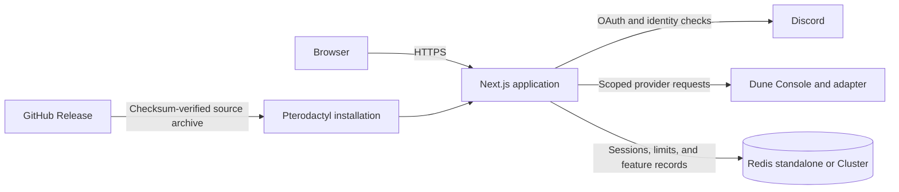

Feature code lives in `src/features/`, route entry points in `src/app/`, shared UI in `src/components/`, and request/provider infrastructure in `src/server/`. See [file organization](docs/architecture/file-organization.md) for placement rules and the [repository inventory](docs/architecture/repository-inventory.md) for the directory map and root-file audit. Assistant setup lives in [AI guide](AGENTS.md#ai-agent-guide).

## Quick start

### Requirements

- Node.js 22 or newer and npm.
- A reachable Dune Console instance and adapter configuration.
- A Discord application configured for OAuth.
- Redis for persistent production sessions and shared limits.

### Install and run

```powershell
npm ci
Copy-Item .env.example .env
npm run dev
```

Fill `.env` using real local or deployment values, then open **http://127.0.0.1:2008**. The launcher prints `Arrakis Control Dashboard is listening` after its HTTP readiness check succeeds.

Never commit `.env` or place secrets in `NEXT_PUBLIC_` variables.

## Environment configuration

Use [`.env.example`](.env.example) as the complete template; every variable, range and production rule is in [environment variables](docs/configuration/environment-variables.md). The main settings are:

| Setting                                                                                       | Purpose                                                                                                                                                                                               |
| --------------------------------------------------------------------------------------------- | ----------------------------------------------------------------------------------------------------------------------------------------------------------------------------------------------------- |
| `DUNE_API_URL`, `DUNE_API_KEY`, `DUNE_ADAPTER_TOKEN`                                          | Dune Console URL, API key and Discord adapter token                                                                                                                                                   |
| `DISCORD_CLIENT_ID`, `DISCORD_CLIENT_SECRET`, `DISCORD_GUILD_ID`                              | Discord OAuth and guild authorization                                                                                                                                                                 |
| `VERIFIED_MEMBER_ROLE_ID`                                                                     | Required member role                                                                                                                                                                                  |
| `MODERATOR_DISCORD_ROLE_IDS`                                                                  | Optional comma-separated Discord roles reserved for moderation; requires server-side bot guild-member access                                                                                          |
| `EVENT_REVIEWER_DISCORD_ROLE_IDS`                                                             | Optional separate Discord roles for event-submission review and judging; requires server-side bot guild-member access                                                                                 |
| `BACKUP_VIEWER_DISCORD_ROLE_IDS`                                                              | Optional separate Discord roles reserved for backup evidence; requires server-side bot guild-member access                                                                                            |
| `APP_URL`                                                                                     | Canonical public origin; the callback is `<APP_URL>/api/auth/callback/discord`                                                                                                                        |
| `AUTH_SECRET`                                                                                 | Signs Auth.js state and seals stored Discord refresh tokens; use at least 32 random characters                                                                                                        |
| `REDIS_URL`                                                                                   | Redis connection, credentials, database, and optional TLS                                                                                                                                             |
| `REDIS_CLUSTER_NODES`                                                                         | Optional Cluster bootstrap nodes; `REDIS_URL` still supplies credentials and TLS                                                                                                                      |
| `TRUSTED_PROXY_COUNT`                                                                         | Exact reverse-proxy count used to select the trusted forwarded address                                                                                                                                |
| `OWNER_KEY_SECRET`                                                                            | Optional dedicated secret for marketplace ownership keys                                                                                                                                              |
| `BOT_API_TOKEN`                                                                               | Optional independent credential for the read-only bot API                                                                                                                                             |
| `DISCORD_BOT_TOKEN`, `COMMUNITY_EVENTS_CHANNEL_ID`                                            | Optional Components V2 community event announcements using the shared main bot; see [Discord announcements](docs/integrations/webhooks.md). Changelogs are posted by the bot from `/api/v2/changelog` |
| `POKER_ACTIVITY_ENABLED`                                                                      | Optional play-money poker Discord Activity; see [Poker Activity](docs/features/poker-activity.md)                                                                                                     |
| `CHAT_ENABLED`, `RABBITMQ_URL`, `CHAT_SERVERS`                                                | Optional live game chat; see the chat guide for the complete worker and history settings                                                                                                              |
| `CHAT_DISCORD_BOT_FUNCOM_ID`                                                                  | Optional exact Discord relay bot identity; requires the `[Discord]` prefix before showing a Discord badge and relayed name                                                                            |
| `RABBITMQ_TLS_ENABLED`, `RABBITMQ_TLS_CA`, `RABBITMQ_TLS_CERT`, `RABBITMQ_TLS_KEY`            | Optional inline PEM trust/client identity; TLS follows the URL scheme by default                                                                                                                      |
| `RABBITMQ_TLS_CA_PATH`, `RABBITMQ_TLS_CERT_PATH`, `RABBITMQ_TLS_KEY_PATH`, `RABBITMQ_CA_FILE` | Path fallbacks; inline PEM takes precedence, legacy CA path remains supported                                                                                                                         |
| `RABBITMQ_TLS_REJECT_UNAUTHORIZED`, `RABBITMQ_TLS_SERVERNAME`                                 | Verification stays enabled; optional DNS identity must match the broker certificate                                                                                                                   |

Redis TLS and public-network settings are validated by the current environment schema. Review `REDIS_REQUIRE_TLS` and `REDIS_ALLOW_INSECURE` before deploying outside a trusted network.

## Production deployment

### Pterodactyl

1. Download `egg-arrakis-control-dashboard.json` from the [latest GitHub Release](https://github.com/RealXKenny/Arrakis-Control-Dashboard/releases/latest).
2. Import the egg into a Pterodactyl nest and create a server with the standard Node.js 22 runtime.
3. Assign the application port and complete the required Startup settings.
4. Keep the server volume writable and make Console, Discord, GitHub, and Redis reachable from the container.

The installer selects the newest release or the exact `RELEASE_TAG`, verifies the release archive against its published SHA-256 checksum, checks archive safety, builds the application, and prunes development dependencies. After that the server keeps itself current: at startup and on a schedule the update supervisor installs verified releases, refuses to overwrite any file you changed or added (`.env`, certificates, custom folders), and rolls back a version that does not start. Pin a version with `RELEASE_TAG`, choose `stable` or `prerelease`, or switch updates off; see [Automatic updates](docs/deployment/automatic-updates.md), including the one-time migration for servers created from an older egg. Live Chat uses the normal Node.js/Pterodactyl startup; see [automatic startup](docs/features/live-chat.md#nodejs-and-pterodactyl-deployment).

### Direct Node.js deployment

```powershell
npm ci
npm run build
npm start
```

Provide the production environment, use HTTPS at the reverse proxy, and configure `TRUSTED_PROXY_COUNT` accurately. Redis is required in production so sessions and rate limits survive restarts and work across instances. Existing deployments adopting hash-tagged keys or Cluster should follow the checked migration commands rather than renaming keys manually.

## Authentication and security

- Redis sessions use opaque cookies and a 30-day lifetime, with explicit sign-out and revocation.
- Discord membership and the required role are re-confirmed after 30 minutes; definitive refusal ends the session. Provider outages allow at most six hours of grace after the last successful confirmation.
- Password login is throttled by address and email. Forwarded addresses are selected using the configured trusted-proxy count.
- Scoped provider credentials, same-origin mutation checks, bounded transfers, and recursive secret redaction protect the API boundary.
- Redacted audit events cover administrative and security-sensitive operations. MFA is not currently implemented.

See [SECURITY.md](SECURITY.md) for reporting and operational guidance. Hardening, known limitations and accepted risks are in [Security](docs/security/README.md); the step-by-step release procedure is the [deployment checklist](docs/deployment/deployment-checklist.md).

## Project structure

```text
src/
├── app/           # Next.js routes, layouts, and framework entry points
├── components/    # Shared navigation, brand, feedback, and UI components
├── features/      # Business domains and their implementations
├── server/        # Shared request infrastructure and provider integrations
├── lib/           # Redis, security, cache, HTTP, formatting, and utilities
├── config/        # Canonical environment and application configuration
├── styles/        # Global styles and design tokens
├── types/         # Shared TypeScript contracts
└── assets/        # Bundled images, terrain, and model resources

scripts/           # Runtime, maintenance, and deployment commands
tests/             # Unit, API, architecture, browser, integration, and load tests
docs/              # Documentation center, architecture notes, legal files, and screenshots
```

## Development

| Command                    | Purpose                                                                        |
| -------------------------- | ------------------------------------------------------------------------------ |
| `npm run dev`              | Start the development server                                                   |
| `npm run ai:check`         | Validate coding assistant configuration                                        |
| `npm run docs:check`       | Validate documentation links and anchors                                       |
| `npm run format:check`     | Check source, test, and script formatting                                      |
| `npm run typecheck`        | Run TypeScript validation                                                      |
| `npm run lint`             | Run ESLint with zero warnings allowed                                          |
| `npm test`                 | Run Vitest unit, API, and architecture tests                                   |
| `npm run test:browser`     | Run Playwright browser tests                                                   |
| `npm run test:production`  | Run the production runtime smoke suite                                         |
| `npm run test:integration` | Run opt-in integration tests against explicitly configured test infrastructure |
| `npm run build`            | Create the production build                                                    |
| `npm start`                | Start the built application                                                    |
| `npm run chat:bridge`      | Standalone diagnostic worker; do not run alongside automatic startup           |

For `test:integration`, set only disposable loopback Redis through `TEST_REDIS_URL` or `TEST_REDIS_CLUSTER_NODES`. Those tests flush the selected test database; never point them at a production instance.

## Troubleshooting

See the full [troubleshooting guides](docs/troubleshooting/README.md). Quick pointers:

- **Discord cannot complete sign-in:** use `<APP_URL>/api/auth/callback/discord` exactly and verify the guild/role configuration.
- **Redis fails in production:** verify credentials, TLS, network reachability, and Cluster settings. Production does not use the development in-memory fallback.
- **A provider feature is unavailable:** installed Console capabilities and key scopes can differ; unknown measurements remain unknown rather than becoming fabricated zeros.

## Contributing

Contributions of code, tests, documentation, accessibility improvements, and bug reports are welcome. Read [CONTRIBUTING.md](CONTRIBUTING.md), follow the [Code of Conduct](CODE_OF_CONDUCT.md), and open a focused pull request with the problem, solution, and verification performed.

Discuss major features or architectural changes before substantial work. Never include credentials, production data, private messages, or real environment files in an issue or pull request.

## License and attribution

Arrakis Control Dashboard is available under the [MIT License](LICENSE). Copyright notices for Arrakis Control Dashboard contributors and RedBlink are preserved there.

The project incorporates or adapts software from RedBlink's [dune-awakening-selfhost-docker](https://github.com/Red-Blink/dune-awakening-selfhost-docker), also under MIT. See [NOTICE.md](NOTICE.md) for attribution and component terms.

This is an independent community project, not affiliated with or endorsed by Funcom or the owners of Dune: Awakening. Third-party names, trademarks, logos, and artwork belong to their respective owners.
