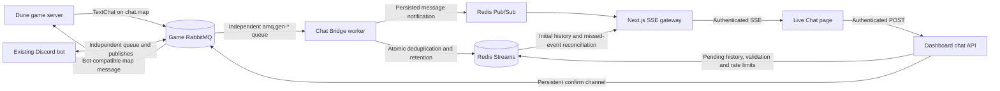

# Live game chat

Live Chat connects authorized dashboard members to Dune: Awakening map chat through the existing game RabbitMQ broker. It uses the same wire protocol as Arrakis Control Bot, a dedicated Chat Bridge worker, bounded Redis Stream history, Redis Pub/Sub live notifications, and an authenticated Server-Sent Events (SSE) gateway.

The bot repository is the protocol reference. In particular, the dashboard mirrors `src/infrastructure/amqp/GameChatConnection.ts`, `src/modules/chat/gameChatProtocol.ts`, and `src/modules/chat/ChatPlayerNames.ts`. No bot queue, Discord route, source file, or runtime behavior is changed by this feature.

## Architecture



Each Next.js process starts one reusable RabbitMQ publisher during instrumentation and uses at most one Redis pattern subscriber. Browsers never connect to RabbitMQ or Redis. The standard launcher starts and supervises one separate worker child before any browser interaction. Each worker owns an exclusive broker-generated receive queue; browser tabs never create consumers.

## RabbitMQ topology and bot compatibility

`chat.map` is an existing direct exchange. Map routing keys are exact and case-sensitive. The dashboard checks this exchange instead of creating or replacing it.

The worker asks RabbitMQ for an unnamed queue with `exclusive=true`, `autoDelete=true`, and `durable=false`. RabbitMQ supplies an `amq.gen-*` name. Like the reference bot, the queue is bounded to 500 ready messages and a 60-second message TTL, and is bound to every configured exact map key. No named queue or custom exchange is declared. `CHAT_BRIDGE_QUEUE` is accepted as a legacy setting but is ignored.

The dashboard and Discord bot own different queues, so both receive a copy without competing. The worker acknowledges valid events only after Redis persistence, uses configurable prefetch, and rejects malformed events without requeueing. Transient processing failures wait one second and then two seconds before requeueing; the third failure rejects and discards the event. No dead-letter queue is created. A worker restart or counter eviction resets its bounded local retry counter; stable external-event deduplication still prevents duplicate history entries. Retry counts are not shared across replicas.

Redis remains persistent history. The temporary queue disappears when its connection closes, and messages sent while all workers are disconnected cannot be recovered. Messages already persisted to Redis survive worker/dashboard restarts subject to retention and Redis durability. Old named dashboard resources, if present, are not modified or deleted.

Outgoing messages preserve the bot contract:

- Exchange `chat.map`; routing key is the selected server's exact `map` value.
- AMQP `contentType=Content`, `type=text_chat`, `appId=fls_backend`, `userId` equal to the persona's hexadecimal account ID, and `headers.redirect_exchange=chat.map`.
- Mandatory publishes with a 60-second broker expiration and publisher confirms. No `persistent`/delivery-mode property is set, matching the reference bot; queue durability does not make these messages persistent.
- Outer `Type=TextChat` and lowercase `content`, containing a JSON string with `m_ChannelType=Map`, an empty recipient, stable `m_Id`, decimal-valued origin coordinates, and the configured Funcom persona.

The dashboard adds `[Dashboard] Display Name: ` to game-bound text. It uses the linked character name for dashboard attribution when available, but never changes the synthetic sender persona or impersonates that player. Messages from the configured dashboard persona are discarded on consume unless they match an explicitly configured Discord relay. Incoming player names are resolved through bounded Console player-directory reads with a 60-second cache; a missing or ambiguous name falls back to the integration-provided display name or Funcom ID.

Set `CHAT_DISCORD_BOT_FUNCOM_ID` to the Discord bot's exact Funcom ID (quote it when it contains `#`). An incoming message is a Discord relay only when both that sender ID and the case-sensitive `[Discord] ` prefix match the bot's `Name: message` or `[Owner] Name: message` format. Verified relays show a Discord badge, the relayed sender's display name, and the message body. Player-written prefix imitations remain Game. `[Owner]` is presentation text, never dashboard authorization; the protocol does not carry a verified Discord user ID. Names containing the `: ` delimiter cannot be distinguished unambiguously from message text; the first delimiter ends the parsed name.

Redis keeps the original text in `content`, records source `discord`, and stores the extracted body in optional `relayContent`. Existing retained `game` records are classified on read using the same exact identity/prefix checks, without rewriting history. Game messages remain Game, and dashboard messages retain their authenticated attribution and publication state.

The worker uses the working bot's resource permission pattern: configure/read/write access for broker-generated `amq.gen-*` queues, read access to `chat.map` for bindings, and write access to `chat.map` for outgoing publishes. It checks the existing exchange rather than declaring it. No additional named-resource permissions or broker configuration changes are required.

## Worker lifecycle, health, and scaling

Start the dashboard normally; with `CHAT_ENABLED=true` it automatically starts the worker:

```bash
npm start
```

Startup validates chat/TLS configuration and Redis before opening RabbitMQ. The worker registers one exclusive-queue consumer and reconnects with exponential backoff capped at 30 seconds plus jitter. Each reconnect restores queue bindings and consumption exactly once. RabbitMQ flow control and a 50-publish bound provide backpressure. The launcher restarts a crashed worker with its own bounded backoff; a Redis outage at worker startup is recoverable through that restart. `SIGINT` and `SIGTERM` stop both children, cancel restarts, reject unresolved publishes as unknown, close the broker connection and health listener, and disconnect Redis. A 15-second deadline bounds shutdown. `npm run chat:bridge` remains a standalone diagnostic command; do not run it beside the automatic worker.

The worker exposes no public port by default. Its loopback HTTP endpoints are:

| Endpoint   | Meaning                                                                                                                           |
| ---------- | --------------------------------------------------------------------------------------------------------------------------------- |
| `/health`  | Process is running and not shutting down                                                                                          |
| `/ready`   | RabbitMQ is ready and Redis answers `PING`; otherwise HTTP 503                                                                    |
| `/metrics` | Non-content counters: received, persisted, duplicates, echoes, rejected, reconnects, pending publishes, blocked state, and uptime |

Logs use the `CHAT BRIDGE` scope. They contain operational metadata, never message bodies or broker credentials. The optional Compose health check uses `/ready`.

Multiple Chat Bridge replicas each receive a copy through their own exclusive queue. Redis's atomic external-ID guard prevents duplicate Stream inserts when an event is redelivered or processed by another replica. Run only the intended number of publishers/workers; scaling does not create exactly-once game delivery.

## Redis history schema

For destination ID `<serverId>`, chat uses a shared Cluster hash tag:

| Key                                              | Purpose                                                         |
| ------------------------------------------------ | --------------------------------------------------------------- |
| `arrakis:{chat:<serverId>}:messages`             | Redis Stream containing retained messages                       |
| `arrakis:{chat:<serverId>}:event:<sha256>`       | Bounded-TTL external event deduplication marker                 |
| `arrakis:{chat:<serverId>}:delivery:<messageId>` | Current outgoing delivery state with the original retention TTL |
| `arrakis:chat:live:<serverId>`                   | Non-durable live notification channel                           |

Each Stream entry has a `payload` field containing the stable message ID, server ID, optional sender ID, display name, source (`game` or `dashboard`), text, ISO timestamp, correlation ID, optional external event ID, and optional delivery state. The Redis Stream ID is added when reading and serves as the pagination/reconnection cursor. It is not used as the external deduplication key.

A single Lua script checks the hashed game `m_Id`, appends the Stream entry, sets the deduplication TTL, applies exact `MINID` age trimming and `MAXLEN` count trimming, and expires idle history. Defaults are 10,000 messages and seven days per destination. Both limits are configurable and all keys for one destination share a Cluster slot. Initial history and older pages contain 50 messages; reconnection reads at most 200 entries per reconciliation pass.

Stream entries are immutable. Delivery changes use an atomic state transition on a separate key with `KEEPTTL`, never `XADD` with an existing Stream ID. History overlays the current state with a same-slot `MGET`. Deduplication and delivery keys expire after the original retention window even if the Stream entry is count-trimmed sooner; their count is bounded by traffic within that window, rather than by the Stream's count cap. Account for these additional keys when sizing Redis. No state update recreates an expired delivery key.

Destination IDs are validated before building hash-tagged keys. Reads reject malformed or cross-destination payloads and apply an age floor even if no recent append has trimmed the Stream. Pagination and reconciliation advance past rejected records, including pages containing no valid messages.

Redis Streams are recent history, not a permanent archive. Use Redis AOF (normally `appendonly yes` with `appendfsync everysec`) and appropriate replication/backups for the desired durability. Redis failover, an AOF fsync window, trimming, retention expiry, or broker downtime can still lose chat. Pub/Sub is never treated as storage.

## SSE gateway and recovery

`GET /api/v2/chat/stream?server=<id>` requires the same opaque session cookie as the workspace and verifies that the destination is configured. The server subscribes to Pub/Sub before reading Stream history and buffers arrivals during that read, closing for resynchronization if the 200-event buffer overflows.

The gateway emits:

- `history`: initial chronological messages and the older-page cursor.
- `message`: a newly persisted message or changed outgoing delivery state; live hints do not advance the resume cursor.
- `resync-complete`: completion of a durable cursor read, carrying its Stream cursor as the SSE ID.
- `gateway-degraded` / `gateway-error`: safe operational failures without credentials or private content.
- `session-ended`: session revalidation failed and the client must sign in again.

Native `EventSource` reconnection sends `Last-Event-ID`. The gateway reads the Stream after that cursor, filters stable-ID duplicates, and permits changed delivery states for an existing outgoing message. Only durable reads advance the resume cursor, so a newer Pub/Sub hint cannot skip an older missed record. Reconnect also refreshes dashboard messages among the latest 200 retained entries, including delivery updates older than the cursor. Every 15 seconds it reconciles the Stream and refreshes up to 100 tracked pending/unknown sends, covering missed Pub/Sub notifications, and sends a heartbeat. Authoritative publication or failure can resolve unknown state; stale pending/unknown events cannot replace confirmed publication. Slow readers exceeding the bounded output buffer are disconnected for native reconnection. Cancellation removes the subscription, timer, and abort listener. Sessions are freshly read and reverified through the existing orchestration every 60 seconds.

## Message lifecycle and delivery states

Game-to-dashboard processing is: consume, validate the 64-KiB envelope and Map-only payload, resolve the configured route and sender, suppress persona echoes, atomically deduplicate/persist, publish a live notification, then acknowledge RabbitMQ. Only public Map chat is accepted; whispers, proximity, guild, party, malformed, oversized, and unconfigured-route events are rejected.

Dashboard-to-game processing is: authenticate, check the configured destination, validate text, apply shared per-member and per-destination limits, derive a stable 32-hex-character ID from the authenticated member and browser UUID `clientKey`, atomically persist `pending`, encode the bot-compatible payload, then wait for publisher confirmation. Concurrent requests with the same key have one publish owner. Reusing the key returns the stored outcome; different content conflicts. Idempotency is destination-scoped and lasts only for the retention TTL. Legacy callers may omit the key, in which case each request is a new send.

| State       | Actual meaning                                                                    |
| ----------- | --------------------------------------------------------------------------------- |
| `pending`   | Saved locally; broker result not established yet                                  |
| `published` | RabbitMQ confirmed broker acceptance; not game-client delivery                    |
| `accepted`  | Reserved for a future integration acknowledgment; not currently emitted           |
| `delivered` | Reserved for actual delivery confirmation; not currently emitted                  |
| `failed`    | The dashboard knows it did not publish, or RabbitMQ rejected/returned the publish |
| `unknown`   | Timeout, disconnect, or another ambiguous outcome; the game may have received it  |

The public chat page labels `published` and `accepted` as **Sent**, failures as **Not sent**, and unknown outcomes as **Unconfirmed**. This changes presentation only: Sent means submission was accepted, not confirmed in-game display. Infrastructure names and internal map routing keys stay out of the public conversation interface. The timeline places your messages on the left and other senders on the right. Dashboard account IDs are authoritative when present; game messages, Discord relays and legacy records without dashboard IDs are matched against your linked character name, Discord username, global display name and server nickname. Names are compared in full after Unicode normalization, trimming and case folding. These matches are presentation hints, not verified account ownership or authorization; duplicate names can look like yours, and the source badge remains unchanged. The page reads your current linked character with a short timeout and falls back to the cached name during Console outages. Your current Discord profile photo appears on your messages, including older history. New dashboard messages retain the authenticated sender’s validated Discord avatar hash for other viewers; arbitrary image URLs are not accepted. Photos are served through the authenticated Redis-backed avatar endpoint described in [Discord integration](../integrations/discord.md#redis-avatar-storage), so browsers never contact the Discord CDN. Missing or unavailable photos fall back to initials, while unmatched Discord relays use the Discord glyph because the game protocol does not identify the individual Discord account. A relay or game message matching your names uses your own cached photo as a presentation hint. Server nicknames are captured at sign-in and ordinary Discord session re-verification. Existing signed-in sessions automatically fetch missing nickname metadata on their next authenticated request, without signing out. Failed backfills retry after five minutes without extending the authorization freshness clock; a confirmed absence is stored as null to prevent repeated requests. A failed optional profile backfill does not invalidate a still-fresh session, while normal role checks, definitive revocations and expiry continue to apply. Source badges, date separators, and the responsive composer remain; uncertain messages retain their warning and deliberate status-check behavior.

The server makes up to **three total publish attempts** for a logical send, waiting one second and then two seconds after confirmed failures. Every attempt uses the same game ID, content, and browser idempotency key, and only the atomic insert winner owns the retry sequence. It stops on success or any unknown outcome. Authentication, validation, and rate-limit rejections are not retried. Configured send limits apply to logical sends; each logical send can incur at most three failed publish attempts.

Pending, failed, and unknown dashboard sends are excluded from shared history and SSE payloads. The gateway can track them privately on the server to repair a missed confirmation, but only confirmed submissions enter the shared conversation. Internal Stream/state records remain retention-bounded for idempotency, so a repeated request with the same key reports the prior failure instead of starting another retry sequence. This applies to older failed records too; no production history purge is needed.

After a confirmed final failure, the sender's optimistic message leaves the timeline and becomes a **Not sent** notice labelled **Only visible to you**, with a **Dismiss message** button. Dismissal changes only that browser's local UI; it sends no deletion or resend request. Up to 20 such notices are retained for the open conversation, and they are cleared on leaving it. The browser allows 40 seconds for the bounded server retry sequence.

Browser network loss, abort, proxy failure, and lost broker confirms are unknown outcomes and are **never automatically resent**. The sender retains an Unconfirmed warning. A lost-response placeholder offers a deliberate status check using the same key; if the original request never arrived, this may perform its first publish. It cannot prove game delivery. After two minutes, an unresolved pending record is treated as unknown. If the process crashes between publishing and recording its result, no game acknowledgment exists to determine the outcome. Confirmed broker nacks, mandatory returns, and rejection before publishing are definite failures.

## Authentication, authorization, and security

Every signed-in member with the existing freshly verified Discord guild role may view and send to every destination in `CHAT_SERVERS`. There is no separate per-member map-role system. API handlers and SSE both enforce authentication and the server allowlist; hiding a destination in the browser is not a security control.

The send endpoint enforces same-origin mutation checks, an 8-KiB request bound, text-only content, configurable character limits, and Redis-backed per-member/per-destination rate limits. The default is 10 messages per member and 60 per destination per 10 seconds. Production rate limiting fails closed if Redis is unavailable. RabbitMQ and Redis credentials remain in server-only modules and are never returned to the browser.

React renders message content as plain text. Newlines are supported; NUL and disallowed control characters are rejected. Incoming sender names and content are schema-validated and length-bounded. The game protocol does not execute Console commands, and this feature grants no arbitrary exchange, routing-key, URL, or header input.

For production, use `amqps://` with normal certificate verification. Never disable TLS verification. Keep the broker on a private network or restricted published listener and use least-privilege resource permissions. Inline trust and client identity are described below.

## Inline RabbitMQ TLS

Paste a complete PEM into the ignored `.env`, inside double quotes. Both genuine multiline and literal escaped-newline formats work. These examples show structure only; replace the body with the complete certificate, without ellipses:

```dotenv
RABBITMQ_TLS_ENABLED=true
RABBITMQ_TLS_REJECT_UNAUTHORIZED=true
RABBITMQ_TLS_CA="-----BEGIN CERTIFICATE-----\n[complete Base64 certificate body]\n-----END CERTIFICATE-----"
```

The equivalent multiline format is:

```dotenv
RABBITMQ_TLS_CA="-----BEGIN CERTIFICATE-----
[complete Base64 certificate body]
-----END CERTIFICATE-----"
```

Use the issuing CA certificate/chain for a private CA. An explicitly trusted self-signed server certificate can be the CA trust input; it is not automatically a client identity. Multiple concatenated certificates form a trusted CA bundle. For brokers requiring mutual TLS, additionally supply both `RABBITMQ_TLS_CERT` and `RABBITMQ_TLS_KEY` with the client certificate chain and matching unencrypted private key. Client identity is optional otherwise. No inline key is written to a temporary file.

For each setting, inline PEM wins over `RABBITMQ_TLS_CA_PATH`, `RABBITMQ_TLS_CERT_PATH`, or `RABBITMQ_TLS_KEY_PATH`. The CA path then falls back to legacy `RABBITMQ_CA_FILE`. With no custom CA, Node's normal trusted roots apply. Malformed inline material fails safely without falling back to a path. The shared loader validates certificate blocks, key parsing, matching client public/private keys and the TLS context once per cached configuration. Publisher and consumer use the same loader and retain validated material through reconnections; restart the dashboard after certificate rotation.

TLS is inferred from the URL scheme when `RABBITMQ_TLS_ENABLED` is absent. Explicit values must agree with `amqps://` or `amqp://`; TLS material requires AMQPS. `RABBITMQ_TLS_REJECT_UNAUTHORIZED=false` is rejected. Certificate chain and hostname verification remain active. Prefer a URL DNS hostname listed in the certificate's Subject Alternative Name. If dialing an IP, the certificate needs a matching IP SAN, or an explicit `RABBITMQ_TLS_SERVERNAME` identifying the real broker certificate DNS identity. That setting supplies SNI and the identity to verify; it does not bypass hostname checks. Replace a mismatched certificate or use its correct identity. Older explicitly trusted certificates without SAN may use Node's standard Common Name fallback for DNS names.

Keep `.env` readable only by the application account (for example `chmod 600 .env` on Linux and equivalent restrictive Windows ACLs). Never commit PEMs/private keys or expose them through logs, APIs, health checks or browser code. Configuration and connection errors name settings and safe corrective actions without printing material or credential-bearing URLs.

## HTTP API

| Method and route                                         | Purpose                                                  | Success response                 |
| -------------------------------------------------------- | -------------------------------------------------------- | -------------------------------- |
| `GET /api/v2/chat/stream?server=<id>`                    | Authenticated SSE history and live subscription          | `text/event-stream`              |
| `GET /api/v2/chat/history?server=<id>&before=<streamId>` | Load up to 50 older entries before an exclusive cursor   | `{ok,messages,nextCursor}`       |
| `POST /api/v2/chat/messages`                             | Send `{serverId,content,clientKey?}` to a configured map | 201 with the `published` message |

Send responses can also be 202 for `pending`/`unknown` or 503 for `failed`; they include the recorded message and a safe error. Authentication, validation, idempotency conflict, unknown destination, rate-limit, and oversized-body failures use the standard API error shape.

## Environment variables

| Variable                                                                  | Default                     | Purpose                                                                                                            |
| ------------------------------------------------------------------------- | --------------------------- | ------------------------------------------------------------------------------------------------------------------ |
| `CHAT_ENABLED`                                                            | `false`                     | Enables dashboard chat and requires the broker, persona, and destinations in production                            |
| `RABBITMQ_URL`                                                            | unset                       | `amqp://` or `amqps://` game-broker URL; username must be the 16-hex persona account ID and a password is required |
| `CHAT_BRIDGE_FUNCOM_ID`                                                   | unset                       | Exact synthetic Funcom sender ID used by the bot protocol                                                          |
| `CHAT_DISCORD_BOT_FUNCOM_ID`                                              | unset                       | Exact trusted Discord relay bot sender ID; requires matching `[Discord]` format                                    |
| `CHAT_BRIDGE_DISPLAY_NAME`                                                | unset                       | Optional spoofed display-name field; leave unset for native persona lookup                                         |
| `CHAT_SERVERS`                                                            | unset                       | 1–100 unique JSON `{id,label,map}` entries; lowercase slug IDs and exact map keys                                  |
| `RABBITMQ_CA_FILE`                                                        | unset                       | Optional trusted public CA/self-signed broker certificate path                                                     |
| `RABBITMQ_TLS_ENABLED`                                                    | inferred                    | Optional TLS switch; must agree with the URL scheme                                                                |
| `RABBITMQ_TLS_CA`                                                         | unset                       | Inline trusted PEM certificate/bundle; overrides paths                                                             |
| `RABBITMQ_TLS_CERT`, `RABBITMQ_TLS_KEY`                                   | unset                       | Optional matching inline mutual-TLS client identity                                                                |
| `RABBITMQ_TLS_CA_PATH`, `RABBITMQ_TLS_CERT_PATH`, `RABBITMQ_TLS_KEY_PATH` | unset                       | File-path fallbacks when the corresponding inline value is absent                                                  |
| `RABBITMQ_TLS_REJECT_UNAUTHORIZED`                                        | `true`                      | Verification is required; false is rejected                                                                        |
| `RABBITMQ_TLS_SERVERNAME`                                                 | unset                       | Optional valid certificate DNS identity; requires AMQPS                                                            |
| `CHAT_BRIDGE_QUEUE`                                                       | `arrakis.dashboard.chat.v1` | Legacy setting accepted but ignored; receive queues are broker-generated                                           |
| `CHAT_BRIDGE_PREFETCH`                                                    | `20`                        | Unacknowledged consumer messages, 1–100                                                                            |
| `CHAT_BRIDGE_HEALTH_HOST`                                                 | `127.0.0.1`                 | Health-listener bind address                                                                                       |
| `CHAT_BRIDGE_HEALTH_PORT`                                                 | `2010`                      | Health-listener port                                                                                               |
| `CHAT_HISTORY_MAX_MESSAGES`                                               | `10000`                     | Exact per-destination Stream bound, 50–100000                                                                      |
| `CHAT_HISTORY_RETENTION_DAYS`                                             | `7`                         | Age and idle-key retention, 1–90 days                                                                              |
| `CHAT_MESSAGE_MAX_CHARS`                                                  | `1000`                      | Outgoing text limit, 100–1800 characters                                                                           |
| `CHAT_SEND_RATE_LIMIT`                                                    | `10`                        | Per-member sends per window                                                                                        |
| `CHAT_SERVER_SEND_RATE_LIMIT`                                             | `60`                        | Per-destination sends per window                                                                                   |
| `CHAT_SEND_RATE_WINDOW_SECONDS`                                           | `10`                        | Shared limit window, 1–300 seconds                                                                                 |

See the committed `.env.example` for a valid destination example. Quote a dotenv Funcom ID containing `#` so it is not parsed as a comment.

## Node.js and Pterodactyl deployment

Run `npm ci`, `npm run build`, then **`npm start`**. With `CHAT_ENABLED=true`, this starts Next.js and its supervised Chat Bridge child using the same `.env`; no additional process manager or allocation is required. Development uses `npm run dev` with the same automatic lifecycle. Do not also launch `npm run chat:bridge`, since the launcher already owns one worker.

The Pterodactyl egg's exact existing startup command remains `cd /home/container && exec node scripts/server-launcher.mjs start`. It now receives the same automatic worker behavior. Keep `tsx` and `amqplib` installed as production dependencies. The worker health listener defaults to `127.0.0.1:2010`; `/ready` checks both RabbitMQ and Redis, without publishing a public worker port. Restart the parent launcher after environment changes. Stop the launcher normally to stop both children; avoid forcibly killing only its parent process.

## Testing and live verification

Unit and integration coverage lives under `tests/unit/chat/` and `tests/integration/redis-chat.test.ts`; transport mocks must not be presented as live broker verification. Run:

```bash
npm run format:check
npm run typecheck
npm run lint
npm test
npm run build
npm run test:production
npm run test:browser
# With a disposable test Redis only:
npm run test:integration
```

A deployment is live-verified only after a real game/broker test in both directions: send a unique dashboard message and visually confirm it in game, then send a game Map message and confirm one dashboard entry with the correct destination. Also restart the worker during a test, reconnect a browser, and check `/ready`. Publisher confirmation alone never passes this test.

## Troubleshooting and failure recovery

| Symptom                                  | Check                                                                                                          |
| ---------------------------------------- | -------------------------------------------------------------------------------------------------------------- |
| Page says chat is not configured         | `CHAT_ENABLED=true` in the dashboard environment; restart Next.js                                              |
| Worker repeatedly reconnects             | AMQP listener, firewall, URL-encoded credentials, vhost, and TLS certificate identity                          |
| `ACCESS_REFUSED` on named resources      | Verify the worker uses a broker-generated queue; update older named-queue builds                               |
| Bot receives chat but dashboard does not | Worker readiness, exact map bindings, generated queue consumer, and persistence errors                         |
| Broker confirms but game shows nothing   | Persona lookup/platform metadata and live player map bindings; broker confirmation is not display confirmation |
| Dashboard messages appear twice          | Stop unintended duplicate publishers; check stable message IDs and do not manually replay an unknown send      |
| Live events stop without disconnecting   | Inspect Redis subscriber logs; the 15-second Stream reconciliation should restore entries                      |
| Older messages disappeared               | Count/age retention, Redis eviction policy, AOF/replication, or failover data-loss window                      |
| Poison events accumulate                 | Check safe validation/retry diagnostics; rejected events are discarded without a custom dead-letter queue      |

During RabbitMQ downtime or worker disconnection, the temporary receive queue provides no offline backlog. During Redis downtime, consumption is retried and then discarded after the bounded retry limit rather than acknowledged as stored. Browser disconnects recover only messages still present in the bounded Stream. There is no guarantee of permanent history, zero loss, exactly-once game display, or replay of expired events.

## Known limitations and future extensions

- Only game Map chat is supported. Proximity, whisper, guild, party, moderation, muting, search, and custom channels are not implemented.
- `accepted` and `delivered` require a future game/integration acknowledgment contract; none exists in the inspected bot protocol.
- Online player count and game-server health are not inferred from chat connectivity.
- All verified dashboard members can use all configured destinations; finer per-member destination roles would require a new authorization policy.
- No custom dead-letter resources are required. Invalid or repeatedly failing events are discarded; there is no automatic replay.
- Reconnection refreshes only the latest 200 entries and live reconciliation tracks at most 100 unresolved sends. Older unresolved records require a fresh history read; a process crash can leave their outcome permanently unknown.
- Each browser timeline retains at most 10,000 messages, dropping its oldest visible records as newer ones arrive. Server retention can be configured separately; older pagination cannot expand the browser beyond this bound.
- Disposable Redis standalone/Cluster, real RabbitMQ permissions/TLS, and both directions of game chat require infrastructure verification in the deployment environment. Loopback TLS handshakes, mock transport and browser fixtures do not establish live game integration.
- Future moderation, search, notifications, and Discord synchronization should consume the normalized persisted contract without changing the bot-compatible transport.
