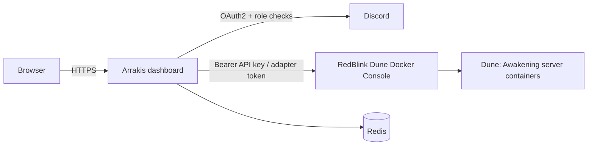

# Introduction

## What it is

Arrakis Control Dashboard v2 is a Next.js 16 application (React 19, TypeScript, Tailwind CSS v4) for communities that
run a self-hosted Dune: Awakening server. Members sign in with Discord and see their character, holdings, vehicles,
maps, the market and guilds. Authorized administrators get a scoped administration workspace over the server's
Console API.

The dashboard is **a client of your server stack, not the stack itself**:

| Project                                                            | Role                                                                                                                         |
| ------------------------------------------------------------------ | ---------------------------------------------------------------------------------------------------------------------------- |
| [RedBlink Dune Docker](https://github.com/Red-Blink/dune-awakening-selfhost-docker) | Runs the Dune: Awakening server in Docker and exposes the **Console** web UI and HTTP API (default port `8088`). |
| Arrakis Control Dashboard (this repository)                        | A separate web application that calls the Console API and the Console's Discord adapter on behalf of signed-in members.     |
| Redis                                                              | The dashboard's only persistent store: sessions, accounts, rate limits, guild data, marketplace, audit trail.                |
| Discord                                                            | Sign-in (OAuth2) and the guild role that decides who may use the dashboard.                                                  |

## What it does

- Discord sign-in and email/password sign-in linked to a Discord-verified email; roles re-verified against Discord.
- Member pages: [portal](../features/dashboard.md), character, holdings, storage, [vehicles](../features/vehicles.md),
  [market](../features/dashboard.md), [maps](../features/maps.md).
- [Guilds](../features/guilds.md), [recruitment and applications](../features/guild-recruitment.md), private chat.
- The [base marketplace](../features/marketplace.md) (share and import blueprints with preview pictures).
- The [administrator panel](../features/administrator-panel.md): a 383-operation catalog over the Console API with
  step-up re-authentication, confirmations and an [audit trail](../features/audit-logs.md).
- A read-only [bot API](../api/server.md#bot-world-summary) and optional [Discord webhook announcements](../integrations/webhooks.md).

## What it does not do

- It does not install, start, update or back up the game server, Docker, or the RedBlink Console. Those belong to
  RedBlink Dune Docker. See [RedBlink integration](../integrations/redblink-dune-docker.md).
- It has no PostgreSQL or other database; there is no SQL to run. See [Redis](../configuration/redis.md).
- It has no Docker image or Compose file. Supported deployments are Node.js directly (Linux or Windows) and the
  [Pterodactyl egg](../installation/pterodactyl.md).
- It does not implement multi-factor authentication or "sign out everywhere" in the UI. See
  [security overview](../security/security-overview.md#known-limitations-and-accepted-risks).

## Where to go next

[Requirements](requirements.md) · [Quick start](quick-start.md) · [End-to-end setup](end-to-end-redblink-setup.md)
