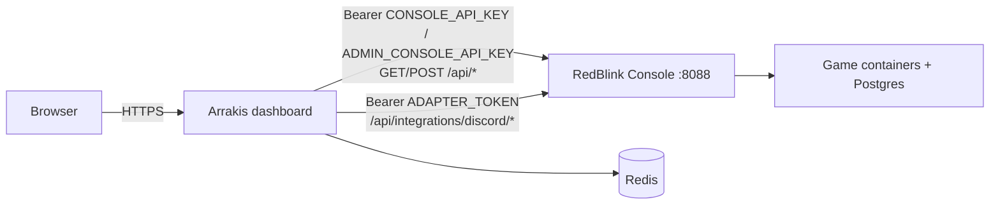

# RedBlink Dune Docker

> **Attribution.** [dune-awakening-selfhost-docker](https://github.com/Red-Blink/dune-awakening-selfhost-docker) is an
> independent project by **RedBlink**, MIT licensed, Copyright (c) 2026 RedBlink. Arrakis Control Dashboard incorporates or adapts
> software from it (see [NOTICE](../../NOTICE.md), [LICENSE](../../LICENSE) and [third-party licenses](../legal/THIRD_PARTY_LICENSES.md)).
> This page is an original explanation based on RedBlink's published `docs/` folder (reviewed November 2026). The RedBlink docs
> and code are not Arrakis work, and where this page and the RedBlink docs disagree, **RedBlink's docs win** for RedBlink behaviour.
> Arrakis Control Dashboard is not affiliated with Funcom or the Dune IP owners ([trademarks](../legal/TRADEMARKS.md)).

## What each project is

| | RedBlink Dune Docker | Arrakis Control Dashboard |
| --- | --- | --- |
| Purpose | Host and operate a Dune: Awakening dedicated server in Docker | A web dashboard for your community and administrators |
| Provides | Orchestrator (SteamCMD game files), gameplay containers (Postgres, RabbitMQ, TextRouter, Director, Gateway, world servers), the **Console** (API and Web UI), the `dune` CLI, backups, updates, optional metrics, public-probe, TLS front, Community Addons, Discord adapter | Next.js app: Discord sign-in, member pages, guild tools, base marketplace, administrator workspace over the Console API, Redis-backed sessions |
| Runs | Docker on a Linux host (`dune` CLI, Compose files `docker-compose*.yml`, raw `docker run` for gameplay) | Node.js 22 (directly or via Pterodactyl) |
| Data | Game Postgres, `runtime/secrets`, `runtime/generated`, `.env` | Redis only |

**The dashboard does not install, update, start, stop or back up the RedBlink stack.** It only calls the Console's HTTP API
and Discord adapter with the credentials you give it. Server start/stop/update through the dashboard happens only as Console
operations in the [administrator panel](../features/administrator-panel.md), if your key allows them and the Console supports them.

## How they connect



| Concern | Belongs to | Setting |
| --- | --- | --- |
| Console URL, port | RedBlink Console (`ADMIN_BIND_PORT`, Settings → Web Console Port, default `8088`) | `CONSOLE_URL` in the dashboard |
| Console admin password | RedBlink (`runtime/secrets/admin-web-password.txt`) | **Not used by the dashboard** |
| API keys | RedBlink Console, Settings → API Keys | `CONSOLE_API_KEY`, `ADMIN_CONSOLE_API_KEY` |
| Adapter enable + token | RedBlink `.env`: `DUNE_DISCORD_ADAPTER_ENABLED`, `DUNE_BOT_API_TOKEN_FILE` or `DUNE_DISCORD_ADAPTER_TOKEN` | `ADAPTER_TOKEN` (same value) |
| Adapter roles | RedBlink `.env`: `DISCORD_OBSERVER_ROLE_IDS`, `DISCORD_MODERATOR_ROLE_IDS`, `DISCORD_ADMIN_ROLE_IDS`, `DISCORD_OWNER_ROLE_IDS` | Not read by the dashboard |
| Console IP allow-list | RedBlink `.env`: `ADMIN_ALLOWED_IPS` | The dashboard host's address must be allowed if you set it |
| Member sign-in and roles | Discord | `DISCORD_*`, `VERIFIED_MEMBER_ROLE_ID` |
| Sessions, limits, guild data | Redis | `REDIS_URL` |
| HTTPS for browsers | Reverse proxy | `APP_URL`, `TRUSTED_PROXY_COUNT` |

## Install the upstream server

Install and operate RedBlink Dune Docker by following **its** README (one-line installer, requirements and ports tables are
there) and its [operator guide](https://github.com/Red-Blink/dune-awakening-selfhost-docker/blob/main/docs/operator-guide.md).
These are not reproduced here because the one-line installer command is not part of the documentation reviewed for this page.

Documented upstream facts you will need:

- After install, the installer prints the Web UI URL and a generated admin password; it is also persisted at
  `runtime/secrets/admin-web-password.txt`. The password logs in as the `owner` tier.
- **Do not expose the Web UI port (`8088` by default) to untrusted users.** Forward it only to trusted administrators.
- Persistent state: `runtime/secrets/`, `runtime/generated/`, `.env` (git-ignored).
- The `dune` CLI (`dune status`, `ps`, `servers`, `ports`, `update`, `self-update`, `db backup-system`, …).
- Optional **encrypted API access**: a TLS front (`dune-tls-front`, default port `8797`) serving the Console API over HTTPS with its
  own self-signed key that clients pin. The dashboard has no certificate-pinning option; to use it you would need your TLS stack
  to trust that certificate (not tested here).

## Create the Console API keys

In the Console, **Settings → API Keys**. New keys have no access; grant per namespace. Create one member key and, optionally, one
separate administrator key. Suggested scopes are in [Dune Console](../configuration/dune-console.md#suggested-key-scopes). The Console
never lets an API key reach `settings`, `database`, `setup` or `community`, and write actions in `updates` and `addons` are denied.

## Enable the Discord adapter

Documented upstream ([Discord adapter](https://github.com/Red-Blink/dune-awakening-selfhost-docker/blob/main/docs/integrations/discord-integration/README.md)):

```bash
# in RedBlink's .env (docker-compose.web.yml already forwards these; do not duplicate them in the compose file)
DUNE_DISCORD_ADAPTER_ENABLED=true
DUNE_BOT_API_TOKEN_FILE=/repo/runtime/secrets/bot-api-token.txt
```

```bash
mkdir -p runtime/secrets
echo -n "<RANDOM_TOKEN>" > runtime/secrets/bot-api-token.txt
chmod 600 runtime/secrets/bot-api-token.txt
docker compose -f docker-compose.web.yml up -d --build redblink-dune-docker-console
```

Then set the dashboard's `ADAPTER_TOKEN` to the same token. The adapter is disabled by default, read-mostly, bearer-token
protected and role-gated; `/broadcast` stays disabled on the stock compose file. Upstream error meanings:
`404` adapter not enabled, `401` token mismatch, `503` no token/missing token file.

## Connect the dashboard

1. Set `CONSOLE_URL` (e.g. `http://127.0.0.1:8088` when on the same host, or `https://…` remotely), `CONSOLE_API_KEY`,
   optionally `ADMIN_CONSOLE_API_KEY`, and `ADAPTER_TOKEN`.
2. If you set `ADMIN_ALLOWED_IPS` on the Console, include the dashboard host.
3. Start the dashboard; the log should show `Dune Console connection ready`.

## Verify connectivity

```bash
curl -sS -H "Authorization: Bearer $CONSOLE_API_KEY" "$CONSOLE_URL/api/players?page=1&pageSize=1"
curl -sS -H "Authorization: Bearer $ADAPTER_TOKEN"   "$CONSOLE_URL/api/integrations/discord/health"
```

Inside the dashboard: portal shows population, `/admin → Overview` reports the admin key and adapter as configured and healthy.

## Troubleshooting authentication and network issues

| Symptom | Likely cause | Fix |
| --- | --- | --- |
| Dashboard log: Console API request failed | Wrong `CONSOLE_URL`, port, firewall, container down | `curl` from the dashboard host; `dune status` on the game host |
| `401` from the Console | Wrong/disabled/expired key (a bad bearer never falls back to cookies) | Create a new key, update env, restart |
| `403` or empty lists | Key lacks the namespace/action | Edit scopes in Settings → API Keys |
| Adapter `404` | `DUNE_DISCORD_ADAPTER_ENABLED` not `true` | Enable and rebuild the Console container |
| Adapter `401` | `ADAPTER_TOKEN` ≠ Console token | Make them identical |
| Adapter `503` | Token file missing/empty | Create the file, rebuild |
| Works locally, fails from the dashboard host | `ADMIN_ALLOWED_IPS` or firewall | Allow the dashboard host |
| Characters not shown | No Discord↔character link | Link through the adapter flow (`players/link`, `players/link/verify`) |

More: [Console connection](../troubleshooting/console-connection.md) and, for game-server problems, the upstream
[troubleshooting guides](https://github.com/Red-Blink/dune-awakening-selfhost-docker/tree/main/docs/integrations/discord-integration).

## Updating both systems

| What | Command / action | Notes |
| --- | --- | --- |
| Game server files | `dune update` (`check`, `install`, `install-assets`, …) or the Console's Updates page | Upstream; independent of the dashboard |
| The RedBlink stack itself | `dune self-update` (`check`, `list`, `install [latest\|<tag>]`) | Upstream |
| Automatic updates | `dune update auto enable [interval-minutes] …` | Upstream systemd timer |
| Dashboard | [Updating](../installation/updating.md) | Reinstall pinned release on Pterodactyl, or rebuild |

After a Console update re-check key scopes, the adapter token and that the dashboard still connects. Back up first (below).

## Backups and maintenance (upstream)

RedBlink documents three different "backups": database backups (Backups page), **encrypted system backups** (database plus `.env`,
`runtime/generated/`, `runtime/secrets/`; one GPG AES-256 archive; unrecoverable without its passphrase) and the in-game "pick up base"
mechanic. Restores to a different Battlegroup ID require choosing **Adopt Backup ID** or **Keep Current ID**. See
[backups](../administration/backups.md) for how this fits with dashboard backups.

## Security

Keep the Console off the public internet; use separate, minimally scoped keys; never reuse the Console admin password,
API keys and adapter token as the dashboard's other secrets; ship both projects' logs somewhere safe ([security](../security/README.md)).

## Compatibility notes

- Console behaviour changes with RedBlink releases and with Funcom game builds. The RedBlink docs mark game-schema topics as
  "Observed" for a specific build; the dashboard relies only on the HTTP routes listed in
  [Dune Console](../configuration/dune-console.md).
- The exact Console version this dashboard release was developed against is not recorded in the repository. Treat a Console update as a
  change that needs a connectivity re-check.
- The adapter is labelled experimental upstream (`"experimental": true` in its health response).

## Related

[End-to-end setup](../getting-started/end-to-end-redblink-setup.md) · [Dune Console](../configuration/dune-console.md) · [Console API notes](dune-console-api.md)
